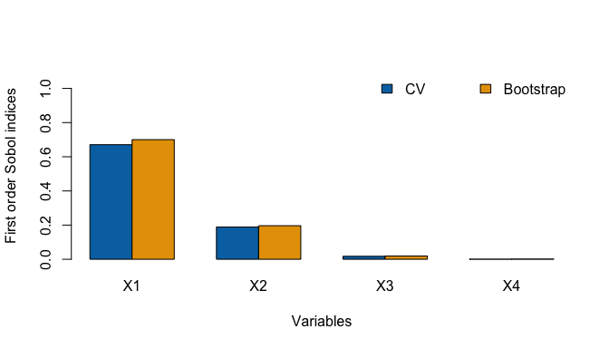

<!-- README.md is generated from README.qmd. Please edit that file -->

# sobolnp

<!-- badges: start -->

[](https://CRAN.R-project.org/package=sobolnp)
[](https://github.com/maikol-solis/sobolnp/actions/workflows/R-CMD-check.yaml)
<!-- badges: end -->

**First-order Sobol sensitivity indices from the data you already
have.** sobolnp estimates how much of the variance of an output $Y$ is
explained by each input $X_i$,

$$
  S_i
  = \frac{\operatorname{Var}\left( \mathbb{E}[Y \mid X_i] \right)}{\operatorname{Var}(Y)},
$$

using only a sample of $(X, Y)$. It does not need to run the model again
and does not need to know its formula.

## Why sobolnp?

Most Sobol estimators are built for a computer model that you can call
at will. They evaluate it on a specially designed set of points, usually
many times. That is a problem when each model run is expensive, when the
model is a black box you can no longer run, or when all you have is
observational data.

|  | Monte Carlo / pick-freeze<br>(Sobol, Saltelli, Jansen, …) | FAST | Metamodel<br>(splines, kriging) | **sobolnp** |
|----|:--:|:--:|:--:|:--:|
| Needs to run the model | yes | yes | to train it | **no** |
| Needs a designed sample | yes (frozen copies) | yes (frequency design) | yes (training design) | **no, any i.i.d. sample** |
| Model runs typically needed | $10^4$–$10^5$ | $10^3$–$10^4$ | $10^2$–$10^3$ + fitting | **the sample you have ($10^2$–$10^3$)** |
| Finite-sample bias correction | — | — | depends on the metamodel | **bootstrap reduces the CV bias** |

sobolnp is a good fit when:

- you only have a data set, or the model is too expensive to evaluate
  again;
- the relation between inputs and output is unknown and possibly
  strongly non-linear;
- you want two complementary estimates (CV and bootstrap) instead of a
  single smoother with a default bandwidth.

In the reference paper (Solís 2021), 1,000 observations of a hydraulic
dyke model gave the same ranking of inputs as classic Monte Carlo
estimates based on $10^5$ model runs, with similar values for the
dominant inputs.

Other estimators that work from given data exist, for example the rank-
and nearest-neighbour-based estimators in the
[sensitivity](https://CRAN.R-project.org/package=sensitivity) package.
What sobolnp adds is a smooth non-parametric fit of every
$\mathbb{E}[Y \mid X_i]$ together with a bandwidth chosen to reduce the
bias of the index.

## How it works

1.  **Fit.** For each input, $\mathbb{E}[Y \mid X_i]$ is estimated by
    kernel (Nadaraya–Watson) regression with an Epanechnikov kernel,
    using [np](https://CRAN.R-project.org/package=np). The index is the
    variance of the fitted curve divided by the variance of $Y$.
2.  **CV bandwidth.** The bandwidth is first chosen by least-squares
    cross-validation. It works asymptotically, but in finite samples it
    over-smooths and tends to *underestimate* $S_i$.
3.  **Bootstrap bandwidth.** The residuals of the CV fit are rescaled
    and resampled to build `nboot` bootstrap responses. For a candidate
    bandwidth, the bootstrap fits measure how much smoothing flattens
    the curve, and that amount is added back to the CV curve. The
    bandwidth is searched below the CV bandwidth, and the resulting
    index is reported as the bootstrap estimate.

`sobolnp()` reports both estimates, so you can see how much the
correction matters for each input.

## Example

The g-Sobol function is a standard, strongly non-linear benchmark with
known indices:

$$
  Y = \prod_{i=1}^{4} \frac{|4X_i - 2| + a_i}{1 + a_i},
  \qquad
  X_i \sim \mathcal{U}(0, 1),\quad a = (0, 1, 4.5, 9).
$$

``` r
library(sobolnp)

a <- c(0, 1, 4.5, 9)
g_sobol <- function(X) {
  apply(X, 1, function(x) prod((abs(4 * x - 2) + a) / (1 + a)))
}

set.seed(123)
X <- matrix(runif(4 * 1000), ncol = 4)
Y <- g_sobol(X)

estimation <- sobolnp(Y = Y, X = X, nboot = 100, verbose = FALSE)
estimation
#> 
#> Call:
#> sobolnp(Y = Y, X = X, nboot = 100, verbose = FALSE)
#> 
#> Number of observations: 1000 
#> Number of variables: 4 
#> 
#> First order indices
#>        Si CV   bw CV Si Bootstrap bw Bootstrap
#> X1 0.6705288 0.03226     0.700250     0.001465
#> X2 0.1887558 0.04239     0.196459     0.004435
#> X3 0.0174166 0.08971     0.019063     0.009809
#> X4 0.0006614 0.18639     0.001178     0.034906
```

Compared with the exact values:

``` r
V <- 1 / (3 * (1 + a)^2)
round(cbind(exact = V / (prod(1 + V) - 1),
            CV = estimation$S,
            bootstrap = estimation$Sboot), 3)
#>    exact    CV bootstrap
#> X1 0.716 0.671     0.700
#> X2 0.179 0.189     0.196
#> X3 0.024 0.017     0.019
#> X4 0.007 0.001     0.001
```

``` r
plot(estimation)
```



## Reading the results

- **Ranking first.** Both estimates usually agree on which inputs
  matter. This is the most reliable output.
- **CV below, bootstrap closer.** For influential inputs, the CV
  estimate tends to fall below the true index. In simulations with the
  default kernel (g-Sobol, Ishigami and an additive model with noise,
  $n = 300$), the bootstrap estimate reduced that bias and had a lower
  average error than CV, although on individual samples CV is sometimes
  closer.
- **Kernel order.** With `ckerorder = 4` the CV estimate is already less
  biased, and the bootstrap correction can overshoot. The default
  (`ckerorder = 2`) is the recommended setting.
- **Non-influential inputs.** When $\mathbb{E}[Y \mid X_i]$ is flat, the
  selected bandwidth becomes very large and $S_i \approx 0$. This is the
  expected result, not a failure.
- **Scope.** Only first-order indices are estimated. Interaction and
  total indices are not. Weak or very irregular effects can be
  underestimated.

## Main arguments

| Argument | Default | Purpose |
|----|----|----|
| `nboot` | `100` | Bootstrap samples. More is more stable and slower. |
| `bootstrap` | `TRUE` | `FALSE` returns only the fast CV estimates. |
| `ckerorder` | `2` | Kernel order (2, 4, 6 or 8). |
| `bandwidth`, `bandwidth.compute` | `NULL`, `TRUE` | Starting bandwidths, or fixed ones with `bandwidth.compute = FALSE`. |
| `mc.cores` | `1` | Inputs processed in parallel (Unix-alikes). |
| `verbose` | `TRUE` | Progress messages and bars. |

The cost grows with the number of inputs × `nboot`. For a first look at
many inputs, run with `bootstrap = FALSE`, then bootstrap the relevant
ones.

## Installation

``` r
# From CRAN
install.packages("sobolnp")

# Development version
# install.packages("pak")
pak::pak("maikol-solis/sobolnp")
```

## Citation

If you use sobolnp, please cite (also available with
`citation("sobolnp")`):

> Solís, M. (2021). Non-parametric estimation of the first-order Sobol
> indices with bootstrap bandwidth. *Communications in Statistics -
> Simulation and Computation*, 50(9), 2497–2512.
> <https://doi.org/10.1080/03610918.2019.1655575>

## License

MIT © Maikol Solís
